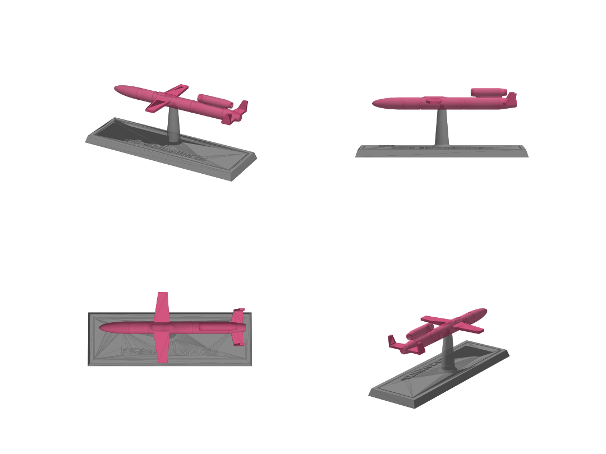

# Пам'ятна мінімодель ракети FP-5 «Фламінго» для 3D-друку



Стилізована модель крилатої ракети FP-5 «Фламінго» на підставці з написом
`FP-5 «ФЛАМІНГО»` та `2025`. Довжина ракети — 120 мм, розмах крила — 58 мм,
підставка — 140 × 46 мм, загальна висота ≈ 55 мм.

## Файли (`stl/`)

| Файл | Що це | Як друкувати |
|---|---|---|
| `fuselage.stl` | Фюзеляж із двигуном на пілоні | На пласкому черевці, як лежить у файлі |
| `wing.stl` | Крило (одна деталь) | Пласко, без підтримок |
| `tail.stl` | H-подібне оперення | Пласко, кілі вгору, без підтримок |
| `stand.stl` | Підставка з написом і штирем | Основою вниз, без підтримок |
| `rocket_full.stl` | Ракета цілком однією деталлю | Для фотополімерного принтера або FDM з підтримками |
| `flamingo_set.3mf` | Набір деталей, уже розкладений на столі | Відкрити в слайсері (Cura, PrusaSlicer, Bambu Studio, Orca) |

## Рекомендовані налаштування (FDM)

- Сопло 0.4 мм, шар 0.12–0.16 мм (для дрібних деталей і напису)
- Заповнення 15–20 %, стінки 3
- PLA; ракету — рожевим пластиком (як у прототипу «Фламінго»), підставку — сірим або чорним
- Напис на підставці опуклий (1 мм): можна змінити колір на висоті 6 мм (M600 / «пауза» у слайсері)
- Підтримки: для деталей набору не потрібні; за бажанням увімкніть «лише від столу» під мотогондолу

## Складання

1. Вставте крило в наскрізний паз у середній частині фюзеляжу та відцентруйте.
2. Вставте оперення в паз у хвості (кілі вгору).
3. За потреби зафіксуйте краплею суперклею.
4. Надіньте ракету отвором у днищі на штир підставки.

Зазори в пазах — 0.25 мм. Якщо сидить туго — злегка пройдіться надфілем або
змініть `FIT` у генераторі.

## Ескіз і розрахунок матеріалу

- `sketch.pdf` (A3, 2 аркуші) / `sketch.png`, `sketch_page2.png` — збірка в 3 виглядах із габаритами та деталі з пазами й посадками
- `MATERIALS.md` — маса, довжина прутка, вартість і час друку по деталях

Разом (PLA, 15 %): ≈ 40 г пластику, ≈ 13 м прутка 1.75 мм, ≈ 28 грн (при 700 грн/кг), ≈ 4.5 год друку.

## Зміна моделі

Модель генерується скриптом `generate.py` (параметрично):

```bash
pip install manifold3d trimesh matplotlib numpy networkx lxml
python3 generate.py   # STL/3MF
python3 drawing.py    # ескіз і розрахунок матеріалу
```

На початку скриптів можна змінити масштаб (`SCALE`), текст написів
(`TITLE`, `SUBTITLE`), розміри підставки, зазори, ціну пластику (`PRICE_PER_KG`) тощо.
